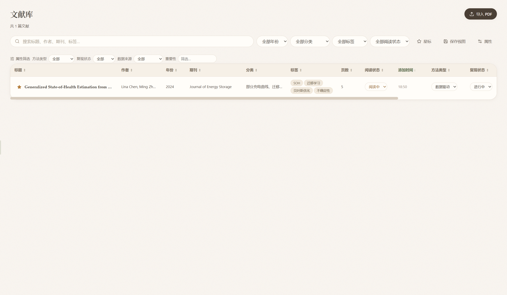

# Arbor

**文献阅读、知识整理与 AI 研究工坊。**

Arbor 是一款本地优先的桌面文献研究工具。它把 PDF 阅读、可追溯的 AI 对话、高亮摘录、灵感收集、研究主题、截图翻译、阅读计划与主题画布放进同一个安静的空间。数据保存在本机，AI 结论尽量回到原文页码。



> 五套可切换主题（暖砂 / 澄蓝 / 柔光 / 暖夜 / 深空）· Windows 10/11

## 功能

- **可拖拽文献列表**：列表整体宽度与列宽都可用鼠标拖动，双击列边界恢复默认。
- **可溯源的 AI 对话**：回答附带原文片段与页码，点击引用回到 PDF；支持「第2—3页」「第1、4页」等页码范围。
- **独立阅读面板**：助手、信息、笔记、高亮、大纲、摘录与任务面板可脱离主窗口，独立窗口支持置顶跟随，页码与大纲同步。
- **阅读器工作台**：PDF 缩放翻页、大纲、高亮、摘录、文献信息、笔记与任务。
- **多主题外观**：内置暖砂、澄蓝、柔光三套浅色与暖夜、深空两套深色主题；在命令面板搜索「主题」即可切换，主窗口与独立阅读面板实时同步。
- **应用内更新**：启动与切换回窗口时检查 GitHub Releases，设置页可下载并校验安装包，完成后直接启动安装。
- **灵感收集**：快速接住文字、链接、摘录与待办，并提供 AI 归类建议。
- **研究主题**：聚合成员文献、建议问题与摘录，进入主题内对话。
- **截图翻译**：全局快捷键框选，保留原图、结构化译文与纯文本。
- **主题阅读计划**：按学习目标生成阅读顺序、关注点与问题清单。
- **主题画布**：文献、摘录与问答卡片连线、分区容器、尺寸调整、画布内文献拖入、缩放与 PNG 导出。
- **本地安全**：API Key 以 Windows DPAPI 加密落盘，界面不回显明文；自动备份保留最近 7 份。

## 下载与在线体验

- **桌面版下载**：请在仓库右侧 **Releases** 中下载最新的 Windows 安装包。
- **在线产品页**：GitHub Pages 首页（功能、截图、使用说明、下载入口）。
- **在线交互 Demo**：`demo.html`，使用模拟数据展示主要界面与交互，不连接真实 AI、不读取本地文件。
- **用户体验问卷**：`questionnaire.html`，10 题、约 2 分钟、匿名且只保存在浏览器。

## 快速开始

### 使用安装包

1. 从 Releases 下载 `Arbor-Setup-x.y.z.exe` 并安装。
2. 打开 Arbor，在「设置」中填写 OpenAI 兼容接口的 Base URL、API Key 与模型名。
3. 点击「测试连接」，保存后导入 PDF 即可开始阅读与提问。
4. 后续版本可在「设置 → 关于与更新」中检查并安装，无需手动重新下载安装包。

### 从源码运行

```bash
npm install
npm run dev      # 开发模式
npm run build    # 构建
npm run dist     # 生成 Windows NSIS 安装包到 release/
```

要求：Node.js 20+、Windows 10/11。

## 快捷键

| 快捷键 | 功能 |
|---|---|
| `Ctrl + O` | 全局搜索 |
| `Ctrl + K` | 命令面板（含主题切换） |
| `Ctrl + N` | 快速收集灵感 |
| `Ctrl + Shift + T` | 截图翻译 |
| `Ctrl + Enter` | 发送对话 |
| `Esc` | 关闭浮层 |

## 数据与隐私

- 文献、笔记、摘录、对话、翻译与截图保存在本机数据目录（默认 `%APPDATA%/Arbor/data`）。
- API Key 通过 Electron `safeStorage`（Windows DPAPI）加密后写入配置，界面始终以密码形式显示。
- AI 请求只会发送到你配置的模型服务；Arbor 不会把文献库上传到自有服务器。
- 首次从旧版 `ZotAgent` 启动时，会自动把旧数据目录迁移到 `Arbor`。

## 技术栈

Electron + React + TypeScript + Vite，PDF.js、react-markdown、KaTeX、lucide-react。产品展示站为零依赖静态 HTML/CSS/JS，发布在 GitHub Pages。

## 目录结构

```
src/main          Electron 主进程、IPC、存储、AI、MCP、备份
src/preload       预加载桥接
src/renderer      React 界面
src/shared        共享类型与 IPC 定义
docs/             GitHub Pages 产品站、在线 Demo、问卷与截图
scripts/          构建、进度审计与截图工具
```

## License

[MIT](LICENSE)
