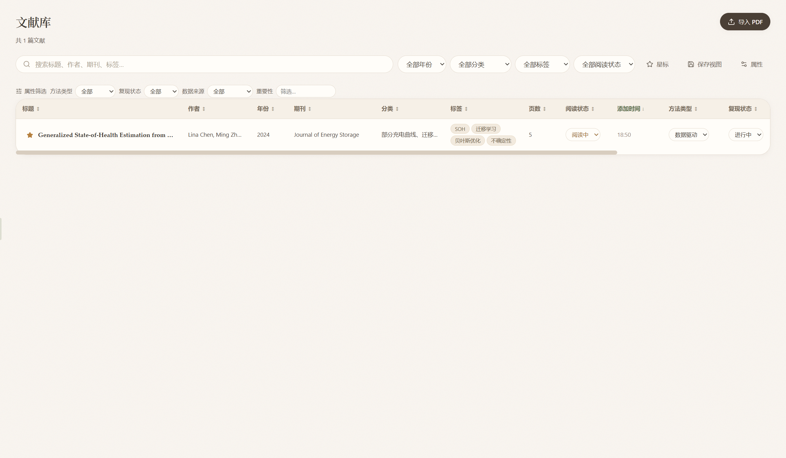

# Arbor

**文献阅读、知识整理与 AI 研究工坊。**

Arbor 是一款本地优先的桌面文献研究工具。它把 PDF、Word、Markdown 与 TXT 文献阅读、可追溯的 AI 对话、高亮摘录、手写标注、阅读色调、灵感收集、研究主题、截图翻译、阅读计划与主题画布放进同一个安静的空间。数据保存在本机，AI 结论尽量回到原文页码。



> 五套可切换主题（暖砂 / 澄蓝 / 柔光 / 暖夜 / 深空）· Windows 10/11

## 功能

- **多级文件夹与颜色**：文献库内提供文件夹目录，兼容原有分类，支持新建多层子文件夹、展开与收起、重命名、移动和子目录文献筛选；可用预设色块、系统调色板或 HEX 色值自定义文件夹颜色。
- **界面字号**：设置页可调整 12–20 px 的软件界面文字，自动保存并同步已有窗口和新窗口；支持恢复默认字号，网页与 PDF 保留独立缩放。
- **批量管理**：文献库、文献问答和阿栗会话列表支持勾选、全选和全不选；文献可批量修改阅读状态、星标、分类和标签，分类与标签支持追加、移除、替换或清空。批量删除前需在弹窗内输入显示的随机六位数字进行确认；宠物聊天小窗也可批量管理阿栗会话。
- **多窗口阅读**：侧栏「新建窗口」或 `Ctrl+Shift+N` 打开新窗口；文献列表和阅读器中的「在新窗口打开」可直接打开对应文献。各窗口独立阅读、翻页与浏览，共享文献库；关闭一个窗口不会关闭其余阅读窗口，可用 Windows 分屏并排对照。
- **网址导入与网页研究**：在文献库点击「导入网页」，保存网址与元信息，直接打开原网页，保留图片、样式与交互。提问时读取当前页面的标题、段落、表格、链接与图片说明；配置视觉模型后可附带当前可见区域截图。支持「问选区」「摘录选区」和保存 MHTML 离线网页。
- **阿栗独立聊天**：与文献上下文无关的陪伴聊天与软件使用助手；支持长期记忆、说明检索、按需联网、语音回答与独立模型配置。侧栏、命令面板与桌面宠物右键均可进入与阿栗聊天。
- **桌面伙伴阿栗**：一只住在透明桌面舞台上的哈士奇，会用动作回应写作、阅读与思考状态；闲置时会安静漫游，右键可触发撒欢跑、叼球与冲刺技能。拖拽可改变位置，单击打开聊天小窗，双击回到主窗口，状态不读取任何文献内容。
- **摸鱼盲盒**：在命令面板搜索「摸鱼盲盒」或右键阿栗，随机抽取一张 10–90 秒的身体、眼睛、思绪或桌面微休息卡片；支持倒计时与最近 8 张去重，不联网、不读取文献，也不记录完成情况。
- **可拖拽文献列表**：列表整体宽度与列宽都可用鼠标拖动，双击列边界恢复默认。
- **可溯源的 AI 对话**：回答附带原文片段与页码，点击引用回到 PDF；支持「第2—3页」「第1、4页」等页码范围。
- **对话字号与提问导航**：对话内按 `Ctrl + 滚轮` 缩放正文字号（80%–200%，重启后保留）；问题导航条展示每个提问的位置，悬停预览、点击跳转并高亮定位。独立成行的公式自动按块级公式排版。
- **独立阅读面板**：助手、信息、笔记、高亮、大纲、摘录与任务面板可脱离主窗口，独立窗口支持置顶跟随，页码与大纲同步。
- **阅读器工作台**：支持 PDF、Word（docx/doc）、Markdown、TXT 导入；PDF 缩放翻页，文本文献自动分页阅读，统一提供大纲、高亮、标注、摘录、文献信息、笔记与任务。
- **PDF 手写标注**：在页面任意位置放置想法/问题贴纸（五色、可标记已解决），或使用画笔、荧光笔与橡皮擦手写批注；支持撤销重做、隐藏标注与按页清空墨迹。贴纸可一键「问 Agent」带入对话，右侧「标注」页签按页汇总贴纸与墨迹。
- **文献阅读色调**：原色、暖纸、护眼、夜间与高对比五种色调，插图与彩色图表保留原色；色调随文献保存并自动沿用上次选择。
- **对话附件与文件交付**：对话可附带图片与文件；AI 可直接生成图片、图表、PDF、表格等交付文件，支持预览、用系统应用打开与另存。
- **用量仪表盘**：统计输入/输出 Token、缓存命中率、首字延迟与生成速度，按模型与功能分类展示调用趋势，并按可调单价估算费用。
- **多语言界面**：支持简体中文、繁體中文与 English；在设置页即时切换，主窗口、独立阅读面板、桌面伙伴、系统对话框与 AI 提示词同步更新。
- **多主题外观**：内置暖砂、澄蓝、柔光三套浅色与暖夜、深空两套深色主题；在命令面板搜索「主题」即可切换，主窗口与独立阅读面板实时同步。
- **应用内更新**：启动与切换回窗口时检查 GitHub Releases，设置页可下载并校验安装包，完成后直接启动安装。
- **灵感收集**：快速接住文字、链接、摘录与待办，并提供 AI 归类建议。
- **研究主题**：聚合成员文献、建议问题与摘录，进入主题内对话。
- **截图翻译**：全局快捷键框选，保留原图、结构化译文与纯文本。
- **主题阅读计划**：按学习目标生成阅读顺序、关注点与问题清单。
- **主题画布**：文献、摘录与问答卡片连线、分区容器、尺寸调整、画布内文献拖入、缩放与 PNG 导出。
- **本地安全**：API Key 以 Windows DPAPI 加密落盘，界面不回显明文；自动备份保留最近 7 份。

## 使用说明

完整的功能介绍、操作步骤、快捷键、备份与迁移方法见 [docs/使用说明.md](docs/使用说明.md)。

## 下载与在线体验

- **桌面版下载**：前往 [Releases](https://github.com/charlie-sys/arbor/releases/latest) 下载最新的 Windows 安装包。
- **在线产品页**：[charlie-sys.github.io/arbor](https://charlie-sys.github.io/arbor/)（功能、截图、使用说明、下载入口）。
- **在线交互 Demo**：[demo.html](https://charlie-sys.github.io/arbor/demo.html)，使用模拟数据展示主要界面与交互，不连接真实 AI、不读取本地文件。
- **使用演示**：[demo/demo-video.mp4](https://charlie-sys.github.io/arbor/demo/demo-video.mp4)，基于 v0.1.7 真实界面的完整流程演示视频（1920 × 1080，约 5 分 42 秒，中文字幕），也可在产品页「使用演示」板块直接播放。
- **用户体验问卷**：已迁移至 [腾讯文档收集表](https://docs.qq.com/form/page/DREh5UExreEdxTm5t)，10 题、约 2 分钟、匿名；`questionnaire.html` 保留为跳转页。

## 快速开始

### 使用安装包

1. 从 Releases 下载 `Arbor-Setup-x.y.z.exe` 并安装。
2. 打开 Arbor，在「设置」中填写 OpenAI 兼容接口的 Base URL、API Key 与模型名。
3. 点击「测试连接」，保存后导入 PDF、Word、Markdown 或 TXT 即可开始阅读与提问。
4. 后续版本可在「设置 → 关于与更新」中检查并安装，无需手动重新下载安装包。

### 从源码运行

```bash
npm install
npm run dev      # 开发模式
npm run build    # 构建
npm run dist     # 生成 Windows NSIS 安装包到 release/
npm run test:research # 网页导入、浏览与问答缓存回归测试（本地模拟服务，无真实模型费用）
```

要求：Node.js 20+、Windows 10/11。

### 文献问答缓存

问答请求将稳定的文献正文置于前缀，将当前页、选文、笔记和本轮检索片段放入本轮消息；这些补充资料随对话保存，追问时重放。历史按字符预算整组裁剪，避免每轮滑动最近 16 条消息而破坏缓存。配置有限上下文预算时，为稳定正文和本轮相关片段分别分配预算。

缓存命中数据来自模型服务端，并非本机复用旧答案；不返回缓存明细的请求不算作零命中。在用量仪表盘使用「功能筛选」可单独查看 AI 对话。首次请求、切换模型或资料、缓存过期仍可能不命中，具体行为由服务商决定，参见 [DeepSeek 上下文缓存说明](https://api-docs.deepseek.com/guides/kv_cache)。

### 直接网页问答与离线网页

网页导入仅保存地址与元信息，不创建 Markdown 正文或分页快照。阅读器默认直接显示网页；问答读取提问时的当前页面，点击链接导航后即可针对新内容提问，无需重新导入。网页引用以来源网址、章节和图表说明定位，不使用 PDF 页码。单独进入网页对话时，会临时加载该页面；页面信息只作为模型上下文，实际使用的来源资料随对话记录保存。

在设置中配置视觉模型，并启用对话中的「页面截图」，即可附带当前可见区域截图供模型识别图片和布局；屏幕之外的图片需要滚动到可见位置后再提问。未配置视觉模型或未提供截图时，回答只能依据文字和图片说明，不把图片网址当作已识别图像。

点击「保存离线网页」会生成独立的 MHTML 归档，包含已加载的 HTML、图片和样式；可切换「离线网页 / 在线网页」。离线阅读本身不访问原站、不执行归档内的页面脚本，仍可进行问答。点击离线页面中的外部网址时，会自动切换到在线网页并显示目标页面，原归档可通过来源选项切回。动态视频、登录交互和未加载的懒加载资源不能保证离线复现；保存前应先展开、滚动加载所需内容。以前保存的 Markdown 正文快照与批注继续保留，可通过阅读器顶部按钮查看。

导入时可点击「取消导入」或按 Esc，停止加载并关闭导入窗口，不保存未完成的文献。网页内容就绪后即可完成导入，不必等图片等次要资源全部加载；开始提交元信息后不再接受取消。

## 快捷键

| 快捷键 | 功能 |
|---|---|
| `Ctrl + O` | 全局搜索 |
| `Ctrl + K` | 命令面板（含主题切换） |
| `Ctrl + N` | 快速收集灵感 |
| `Ctrl + Shift + T` | 截图翻译 |
| `Ctrl + Enter` | 发送对话 |
| `Ctrl + 滚轮` | 缩放对话字号 |
| `Ctrl + Z` / `Ctrl + Shift + Z` | 标注模式下撤销 / 重做 |
| `V` / `N` / `P` / `M` / `E` | 标注模式：选择 / 贴纸 / 画笔 / 荧光笔 / 橡皮擦 |
| `Esc` | 关闭浮层 / 退出标注模式 |

## 数据与隐私

- 文献、笔记、高亮、贴纸与手写标注、摘录、对话、聊天附件、翻译、截图与 Token 用量记录保存在本机数据目录（默认 `%APPDATA%/Arbor/data`）。
- API Key 通过 Electron `safeStorage`（Windows DPAPI）加密后写入配置，界面始终以密码形式显示。
- AI 请求只会发送到你配置的模型服务；Arbor 不会把文献库上传到自有服务器。
- 首次从旧版 `ZotAgent` 启动时，会自动把旧数据目录迁移到 `Arbor`。

## 技术栈

Electron + React + TypeScript + Vite，PDF.js、react-markdown、KaTeX、lucide-react，mammoth / word-extractor 解析 Word 文献。产品展示站为零依赖静态 HTML/CSS/JS，发布在 GitHub Pages。

## 目录结构

```
src/main          Electron 主进程、IPC、存储、AI、MCP、备份
src/preload       预加载桥接
src/renderer      React 界面
src/shared        共享类型与 IPC 定义
docs/             GitHub Pages 产品站、在线 Demo、问卷与截图
scripts/          构建、进度审计与截图工具
```

## License

[MIT](LICENSE)
