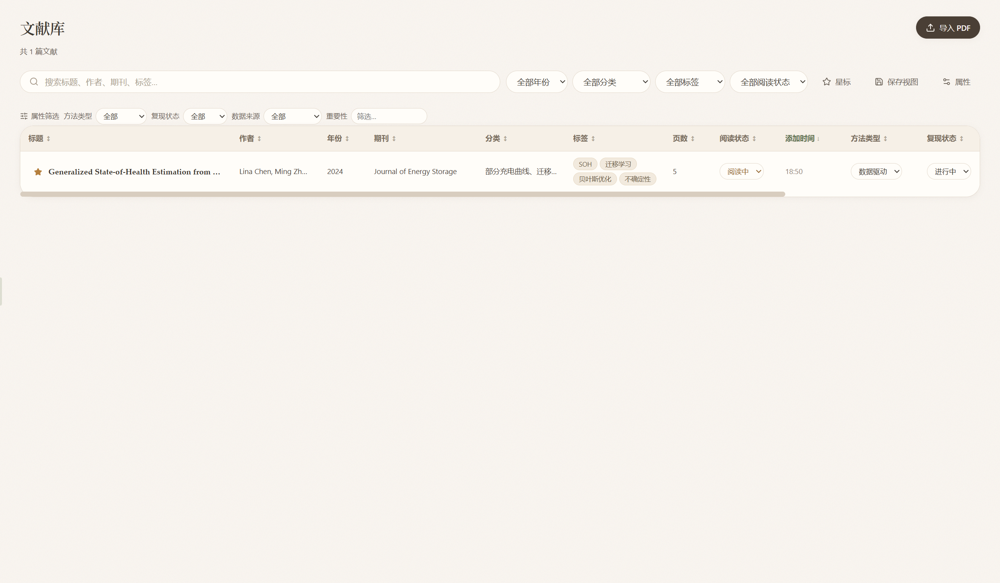
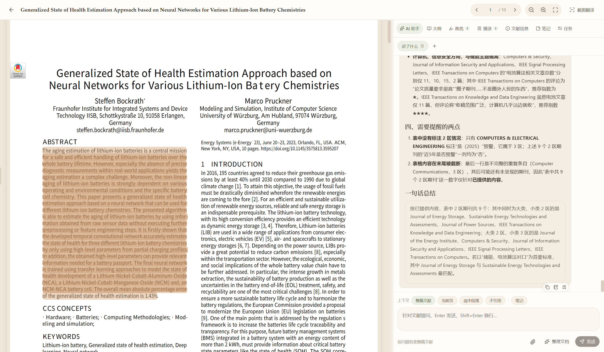
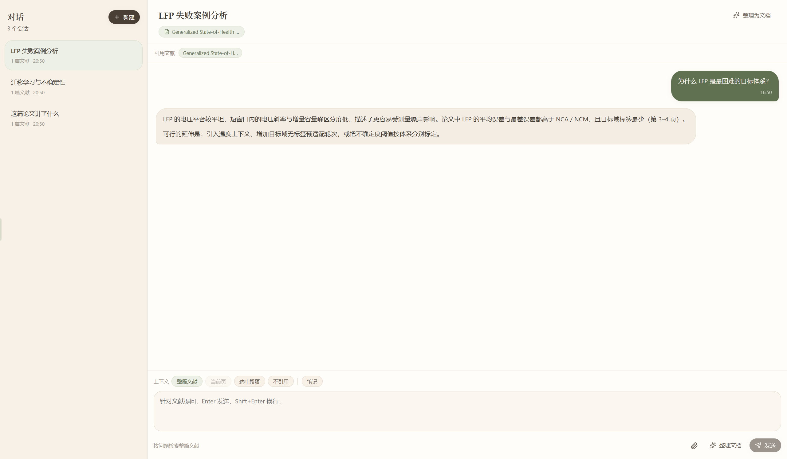
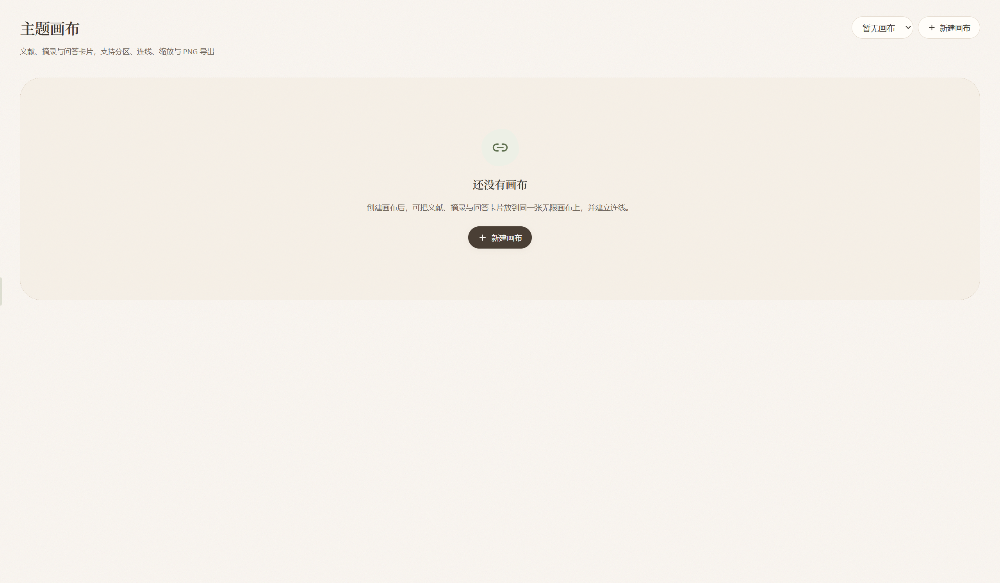
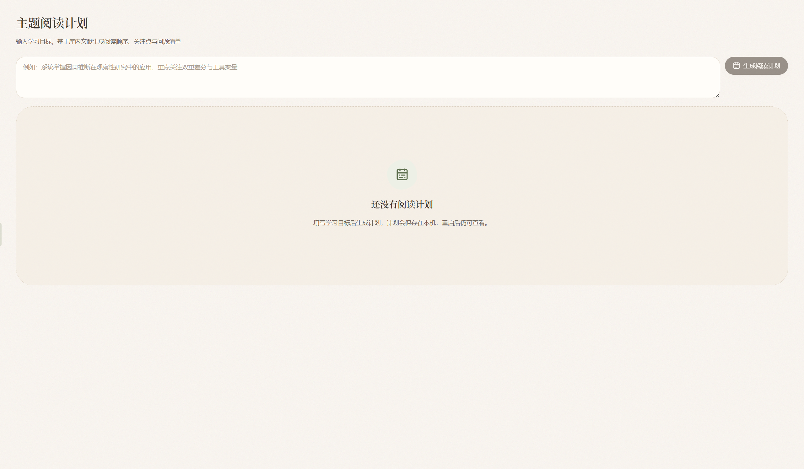
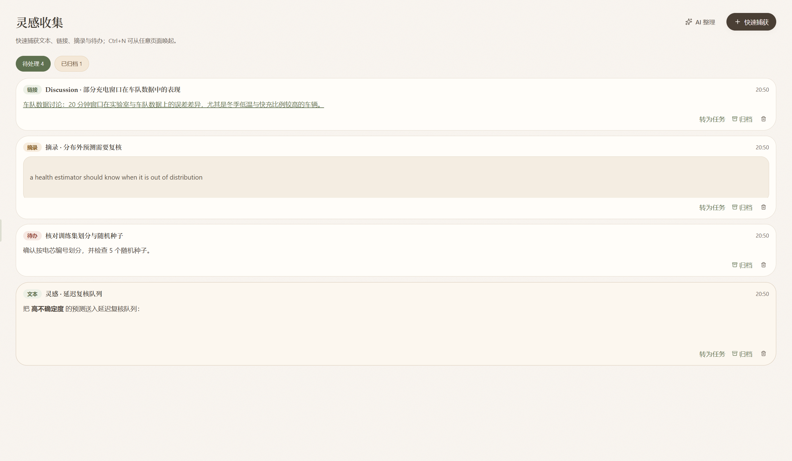
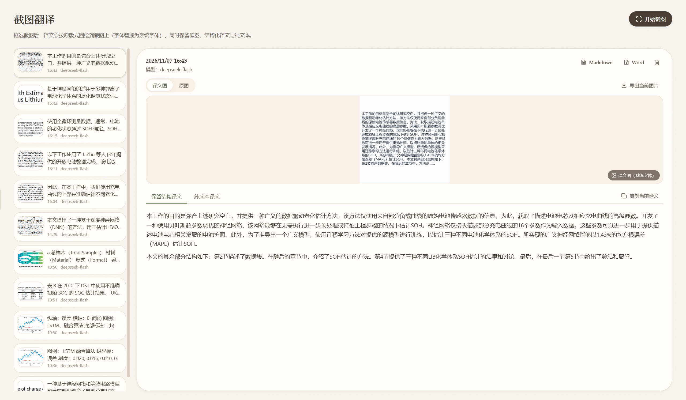
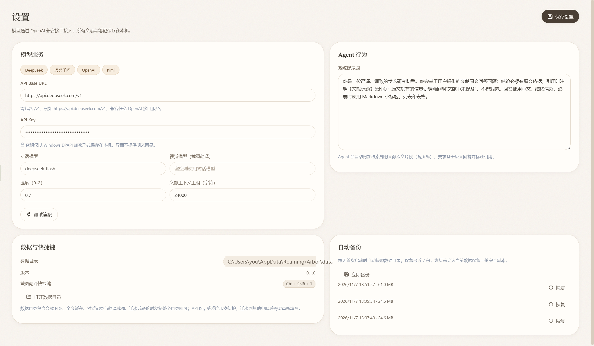
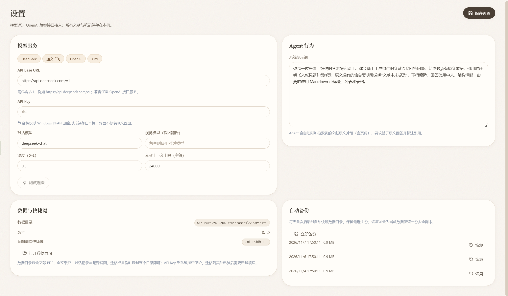

# Arbor 使用说明

> 适用版本：v0.1.6 · 平台：Windows 10/11
>
> Arbor 是一款本地优先的桌面文献研究工具：读文献、问 AI、做摘录、整理想法、画主题画布，数据都保存在你自己的电脑上。



---

## 目录

1. [安装与首次配置](#1-安装与首次配置)
2. [界面总览](#2-界面总览)
3. [文献库](#3-文献库)
4. [阅读器](#4-阅读器)
5. [AI 对话](#5-ai-对话)
6. [研究主题](#6-研究主题)
7. [主题画布](#7-主题画布)
8. [主题阅读计划](#8-主题阅读计划)
9. [灵感收集](#9-灵感收集)
10. [截图翻译](#10-截图翻译)
11. [桌面伙伴阿栗](#11-桌面伙伴阿栗)
12. [用量仪表盘](#12-用量仪表盘)
13. [设置](#13-设置)
14. [快捷键](#14-快捷键)
15. [数据、备份与迁移](#15-数据备份与迁移)
16. [常见问题](#16-常见问题)
17. [从源码运行](#17-从源码运行)
18. [与阿栗聊天](#18-与阿栗聊天)

---

## 1. 安装与首次配置

### 1.1 使用安装包

1. 打开仓库的 **Releases** 页面，下载最新的 `Arbor-Setup-x.y.z.exe`。
2. 双击安装。安装向导允许修改安装目录，并可创建桌面快捷方式。
3. 首次启动后会进入文献库空状态，点击「导入文献」即可开始。

### 1.2 配置模型

打开左侧栏的「设置」，在「模型服务」中填写：

| 项目 | 说明 |
|---|---|
| API Base URL | OpenAI 兼容接口地址，通常需要包含 `/v1`，例如 `https://api.deepseek.com/v1` |
| API Key | 你的模型服务密钥；只保存在本机，使用 Windows DPAPI 加密 |
| 对话模型 | 例如 `deepseek-chat`、`gpt-4.1-mini` 等 |
| 视觉模型 | 用于截图翻译；留空时使用对话模型 |
| 温度 | 0–2，越低越稳定，越高越发散 |
| 文献上下文上限 | 每次问答最多注入多少字符的文献原文；留空或 0 表示不限制 |

设置页提供 DeepSeek、通义千问、OpenAI、Kimi 四个预设，点击即可填入服务地址与模型名。填写完成后点「测试连接」，确认接口可用，再点「保存设置」。

> 如果使用本地模型服务（如 Ollama、LM Studio、vLLM），只要它提供 OpenAI 兼容接口，同样可以填入。

---

## 2. 界面总览

### 2.1 侧栏

左侧栏默认收起。把鼠标移到窗口最左缘，侧栏会滑出；移开后约 0.2 秒自动收起。拖动侧栏右缘可调整宽度（200–380 px），宽度会被记住。

侧栏包含：

- **文献库**：全部文献与分类。
- **AI 对话**：围绕文献的可溯源问答。
- **研究主题**：把一组文献、问题、摘录与对话聚合成一个主题。
- **主题画布**：用卡片与连线梳理文献关系。
- **灵感收集**：快速记录想法、链接、摘录与待办。
- **截图翻译**：框选屏幕区域，识别并翻译。
- **用量仪表盘**：查看 Token、缓存命中与调用趋势。
- **设置**：模型、界面、数据、备份与更新。

底部还有「分类」「保存视图」与截图翻译快捷键提示。

### 2.2 命令面板与全局搜索

- `Ctrl + K`：打开命令面板。可执行导入、导出、打开各页面、切换主题、管理宠物等操作。输入关键词过滤，`↑` / `↓` 选择，`Enter` 执行，`Esc` 关闭。
- `Ctrl + O`：打开全局搜索。可搜索文献标题、作者、摘要、全文、笔记、对话消息、摘录与分类。
  - 结果会标注类型，并显示命中的页码。
  - `Enter` 打开结果；对文献结果按 `Ctrl + Enter` 可直接跳到命中页。
  - 输入为空时会显示最近文献与对话。

### 2.3 未保存保护

文献笔记、文献信息、摘录编辑、灵感编辑、快速捕获、设置等表单有未保存修改时，切换页面的操作会被拦截，并提示「有未保存的修改，请先保存」。独立阅读面板在未保存时也会拒绝关闭。

### 2.4 主题与外观

内置五套主题：暖砂、澄蓝、柔光（浅色），暖夜、深空（深色）。按 `Ctrl + K` 搜索「主题」，或直接使用命令面板中的「切换主题」。主窗口与独立阅读面板会同步换肤。

---

## 3. 文献库

### 3.1 导入文献

点击侧栏顶部「导入文献」，可一次选择多个文件。支持：

- PDF（`.pdf`）
- Word（`.docx`、`.doc`）
- Markdown（`.md`、`.markdown`）
- 纯文本（`.txt`）

导入后 Arbor 会自动提取全文。PDF 还会尝试读取标题、作者、年份、期刊、DOI 与摘要；文本会按页缓存，供阅读、搜索和 AI 检索使用。

> 扫描版 PDF 没有文字层，无法直接提取全文。建议先用 OCR 工具生成可复制文本的 PDF，或在「文献信息」中手动补充摘要与笔记。

### 3.2 表格与筛选

文献以表格呈现，支持：

- 按标题、作者、期刊、标签搜索。
- 按年份、分类、标签、阅读状态筛选。
- 「星标」开关：只看星标文献。
- 拖表头调整列宽，双击列边界恢复默认。
- 点击列头排序，再次点击反向。
- 拖动列表与右侧面板之间的分隔条调整列表宽度。

单行可执行：星标、修改阅读状态、加入分类、与文献对话、删除文献。

> 删除文献会同时删除本地文件和提取文本，且不可恢复。删除前请确认已备份。

### 3.3 分类、标签与属性

- **分类**：支持多级。分类行可「新建子分类」「移动到其他分类」「显示子分类文献」「删除分类」。删除分类时子分类会上移一级，文献本身不会被删除。
- **标签**：可在文献信息或批量编辑中维护，用于筛选和检索。
- **属性**：命令面板搜索「属性管理」，可为文献建立文本、数字、单选、多选、日期、复选框、URL 等自定义字段，并作为表格列展示。

### 3.4 保存视图

在表格工具栏点击「保存视图」，可把当前的搜索词、星标、年份/分类/标签/阅读状态、属性筛选与排序保存下来，之后在侧栏一键恢复。保存视图只保存表格配置。

### 3.5 导入与导出

命令面板中提供：

- **导入 BibTeX（Zotero 导出）**：读取 `.bib` 元数据，按 DOI/标题合并已有文献。
- **导入 Readwise 高亮**：读取 Readwise JSON，按书名关联已有文献。
- **导出当前文档**：导出当前阅读文献的摘要与笔记为 Markdown。
- **导出整库 Markdown**：把文献元数据、笔记、摘录与对话汇总成一个 Markdown 文件。
- **导出整库 ZIP**：Markdown 汇总 + BibTeX 打包。
- **导出 BibTeX**：生成 `.bib` 文件。
- **导出单篇文献包**：打包该文献的 PDF、笔记、摘录与对话。

---

## 4. 阅读器



### 4.1 打开与继续阅读

在文献库点击标题即可进入阅读器。如果该文献有阅读记录，会询问「继续阅读？」：

- 「继续阅读（第 N 页）」：回到上次位置。
- 「从头开始」：从第 1 页开始。

首次打开的未读文献会自动标记为「阅读中」，页码变化后会自动记住位置。

### 4.2 阅读控制

- 顶栏可输入页码跳转，或使用上一页/下一页。
- 缩放：按钮或 `Ctrl + 滚轮`，范围 25%–400%。
- 「适应宽度」：让页面铺满阅读区。
- 返回文献库：点左上角返回按钮。

PDF、Word、Markdown、TXT 共用同一套大纲、高亮、摘录、笔记与任务面板。文本文献会自动分页。

### 4.3 选中文字

<!-- ali:keywords: 高亮,删除高亮,批注,颜色,AI 动作 -->

在正文中选中文字会弹出工具条：

- **五色高亮**：黄、绿、蓝、粉、紫。
- **问 Agent**：把「> 原文（第 N 页）」填入右侧对话，并切换到「选中段落」上下文。
- **AI 动作**：翻译、生成摘要、解释公式、对比文献（对比需要另选一篇文献）。
- **存为笔记**：把原文引用追加到文献笔记。
- **复制**：复制选中文字。

点击已有高亮可修改颜色、填写批注、删除或保存。高亮批注未保存时关闭编辑器会被拦截。

### 4.4 右侧面板

<!-- ali:keywords: 笔记,保存笔记,任务,任务添加,添加任务,大纲,大纲不显示,高亮,摘录,文献信息,独立面板,阅读面板 -->

右侧面板包含以下标签，可拖动宽度：

| 标签 | 用途 |
|---|---|
| AI 助手 | 围绕当前文献提问，支持整篇、当前页、选中段落、不引用 |
| 大纲 | 优先使用 PDF 书签；没有书签时可「按页首行生成」；点击跳页 |
| 高亮 | 按页分组，点击跳回原文，可删除 |
| 摘录 | 查看问题、回答、原文引用；可编辑、加附件、导出 ZIP、删除 |
| 文献信息 | 标题、作者、年份、期刊、DOI、链接、标签、分类、阅读状态、摘要 |
| 笔记 | Markdown + LaTeX 编辑器，支持预览与保存 |
| 任务 | 添加待办与截止日期，按今日到期/未完成/已完成分组 |

点面板右上角的「脱离为独立窗口」，可把面板变成独立窗口。独立窗口支持「置顶窗口」「收回面板」，并与主窗口同步页码、大纲与对话。关闭独立窗口时同样受未保存保护。

### 4.5 翻译抽屉

在阅读器点「截图翻译」可框选当前区域翻译。结果会出现在翻译抽屉或「截图翻译」栏目中，可切换原图/译文图、复制译文、导出 Markdown/Word/图片。

---

## 5. AI 对话



### 5.1 新建对话

进入「AI 对话」后点「新建」：

- 勾选要引用的文献；不勾选则创建「不引用文献」的普通对话。
- 底部显示已选择数量，点「创建对话」。

对话左侧列表按更新时间排序。每个会话显示引用文献数量，可删除。

### 5.2 上下文模式

有引用文献时，输入区上方会出现上下文选项：

- **整篇文献**：在全文范围内检索相关片段。
- **当前页**：只依据当前页回答。
- **选中段落**：优先依据你选中的原文回答。
- **不引用**：不注入任何文献原文。

「笔记」开关可把该文献的笔记一并注入。输入框底部会实时说明当前注入范围。

### 5.3 提问与附件

- `Enter` 发送，`Shift + Enter` 换行。
- 点回形针、粘贴或拖入文件可添加附件。支持图片、文本、Markdown、CSV/TSV、表格文件等。
- 图片附件会交给视觉模型识别；表格附件会转换成文本；文本附件会截取前 12000 字符。
- 生成中显示「正在生成回答…」与「停止」按钮；切换页面会中断生成，历史中会标记回答已中断。

### 5.4 回答与引用

回答完成后，Arbor 会自动识别「第 3 页」「第 2—3 页」「p. 5」等页码并变成可点击链接。回答下方会汇总「引用来源 · N」，点击条目或页码可跳回对应文献页。

每条回答支持：复制回答、存为笔记、存为摘录。用户消息可存为问题。

### 5.5 提问导航与字号

- 顶部问题导航条展示每个提问的位置，悬停预览，点击跳转并高亮。
- 对话内按 `Ctrl + 滚轮` 缩放正文字号，范围 80%–200%，重启后保留。
- 独立成行的公式会按块级公式排版。

### 5.6 整理为文档

点对话顶栏「整理为文档」，可把问答记录、文献笔记、摘录整理成一份结构化文档：

1. 填写文档标题。
2. 勾选要纳入的内容（对话记录、文献笔记、摘录）。
3. 调整章节结构（每行一个 Markdown 标题）。
4. 可填写额外要求，点「生成整理文档」。

生成后可编辑、预览、重新生成、复制，并导出 Markdown 或 Word。

### 5.7 对话用量

输入框下方显示当前对话的首 Token 延迟、输出速度、缓存命中与输入/输出 Token。完整统计见「用量仪表盘」。

---

## 6. 研究主题


研究主题用于把一组文献、问题、摘录与对话聚合成一个研究空间。

1. 进入「研究主题」，点「新建研究主题」。
2. 填写名称并至少勾选一篇文献。
3. 在主题详情中：
   - **成员文献**：点击打开原文。
   - **建议问题**：点「生成建议问题」，或点具体问题直接创建主题对话并自动发送。
   - **主题对话**：打开或新建主题对话；点「生成综述」可让 AI 汇总成员文献。
   - **主题摘录**：查看成员文献的摘录，点卡片编辑，点文献名跳回原文。

删除主题不会删除文献、摘录或对话。

---

## 7. 主题画布



主题画布是一块可无限平移、缩放的卡片白板。

- **新建画布**：顶部选择画布后点「新建画布」，可重命名或删除。
- **添加卡片**：「＋ 添加卡片」可新建分区、文献、摘录、问答卡片。
- **文献侧栏**：把文献拖到画布，或点「+」添加。
- **移动与缩放**：拖动卡片移动；拖动右下角调整大小；空白处拖动平移；滚轮缩放 30%–200%。
- **分区**：落进分区范围的卡片会随分区一起移动。
- **连线**：点「连线」，依次点两张卡片即可；点击连线可删除。
- **导出 PNG**：把全部卡片与连线导出为 2 倍图，文件名取画布名。

画布内容与文献、摘录相互独立；删除画布不会删除文献与摘录。

---

## 8. 主题阅读计划



主题阅读计划不在侧栏，需要通过命令面板打开：

1. 按 `Ctrl + K`，搜索「打开主题阅读计划」。
2. 输入学习目标，例如「系统掌握因果推断」。
3. 点「生成阅读计划」。

计划会列出阅读顺序、每篇文献的关注点与问题清单，可点「开始阅读」或删除。计划保存在本机，删除计划不影响文献。

---

## 9. 灵感收集



灵感收集用于快速接住文字、链接、摘录与待办。

- `Ctrl + N`：从任意页面打开「快速捕获」。
- 选择类型（文本/链接/摘录/待办），填写内容；待办可设置截止日期。
- `Ctrl + Enter` 保存，`Esc` 关闭。
- 待办会同时创建一条任务。

页面中可：

- 点卡片进入 Markdown 编辑器，上传图片/文件、插入附件链接、导出 ZIP。
- 「转为任务」「归档/恢复」「删除」。
- 点「AI 整理」生成归类建议（标签/分类/摘录/任务），确认后才会写入。

---

## 10. 截图翻译



1. 按 `Ctrl + Shift + T`，或点侧栏「截图翻译」→「开始截图」。
2. 在屏幕上拖拽选择区域；`Esc` 取消。
3. Arbor 会截取画面并调用视觉模型识别、翻译。
4. 完成后自动进入翻译栏目。

翻译结果支持：

- 切换「保留结构译文 / 纯文本译文」。
- 切换「译文图 / 原图」。
- 复制译文、导出 Markdown、导出 Word、导出当前图片。
- 删除记录（会同时删除截图文件）。

> 截图翻译需要视觉模型。如果设置中视觉模型留空，会使用对话模型；请确认所用模型支持图片输入。

---

## 11. 桌面伙伴阿栗

阿栗是一只住在桌面右下角的哈士奇。它会用动作回应你的写作、阅读、思考与摸鱼：

- 在设置中可「显示桌面伙伴」「允许说话气泡」。
- 右键阿栗可临时静音。
- 命令面板中可「让阿栗休息 / 唤回阿栗」「重置阿栗的位置」。
- 阿栗的状态只依据输入节奏和当前页面，不读取任何文献内容。

---

## 12. 用量仪表盘

用量仪表盘统计模型调用情况：

- 时间跨度：24 小时、7 天、30 天、90 天、全部。
- 指标卡：输入 Token、输出 Token、缓存命中率、调用次数。
- 图表：Token 用量趋势、缓存命中趋势、模型用量、调用构成、最近调用。
- 调用类型包括：AI 对话、文档生成、截图翻译、阅读操作、阅读计划、主题问题、灵感整理、连接测试。

带 `~` 的数字表示服务端未返回精确用量，由本地估算。可点「清空记录」删除全部统计（不可恢复）。

---

## 13. 设置



设置页分为以下几块：

### 13.1 界面语言

支持简体中文、繁體中文、English。切换后界面、系统对话框与 AI 回答语言会同步更新。如果系统提示词仍是默认值，也会切换为新语言的默认提示词。

### 13.2 模型服务

见 [1.2 配置模型](#12-配置模型)。修改后点「保存设置」。

### 13.3 Agent 行为

可编辑「系统提示词」。默认提示词要求：

- 基于原文回答，引用时注明《文献标题》第 N 页。
- 原文没有的信息明确说明「文献中未提及」。
- 不编造事实。
- 使用当前界面语言和 Markdown 回答。

### 13.4 数据与快捷键

显示数据目录与截图翻译快捷键，可「打开数据目录」。

### 13.5 桌面伙伴

控制阿栗的显示与说话气泡，可把阿栗放回右下角。

### 13.6 关于与更新

- 显示当前版本与检查状态。
- 「检查更新」会读取 GitHub Releases。
- 有新版本时可下载、校验并启动安装。
- 应用启动、每 30 分钟、窗口聚焦或重新联网时会自动检查（10 分钟内不重复）。

### 13.7 自动备份



每天首次启动时自动快照数据目录，保留最近 7 份。也可「立即备份」。恢复前会为当前数据保留一份安全副本，然后应用重新加载。

---

## 14. 快捷键

| 快捷键 | 功能 |
|---|---|
| `Ctrl + O` | 全局搜索 |
| `Ctrl + K` | 命令面板（含主题切换） |
| `Ctrl + N` | 快速收集灵感 |
| `Ctrl + Shift + T` | 截图翻译 |
| `Ctrl + Enter` | 发送对话 / 保存快速捕获 |
| `Ctrl + 滚轮` | 缩放对话字号 / 缩放 PDF |
| `Enter` | 发送对话；在快速捕获中保存 |
| `Shift + Enter` | 对话内换行 |
| `Esc` | 关闭浮层或取消框选 |

---

## 15. 数据、备份与迁移

### 15.1 数据保存在哪里

默认数据目录为：

```text
%APPDATA%\Arbor\data
```

其中包含：

- 文献原文件与提取的全文缓存
- 笔记、高亮、摘录、任务、灵感与主题
- 对话、聊天附件与截图翻译
- Token 用量记录
- `library.json`（文献与设置索引）

API Key 使用 Electron `safeStorage`（Windows DPAPI）加密后写入配置，界面不回显明文。AI 请求只会发送到你配置的模型服务，Arbor 不会把文献库上传到自有服务器。

### 15.2 自动备份

- 每天首次启动自动备份，保留最近 7 份。
- 也可在「设置 → 自动备份」点「立即备份」。
- 恢复时会先把当前数据复制到安全目录，再恢复所选备份并重新加载界面。

### 15.3 迁移到另一台电脑

1. 关闭 Arbor。
2. 复制整个数据目录（默认 `%APPDATA%\Arbor\data`）。
3. 在新电脑安装 Arbor，首次启动后关闭。
4. 用复制的目录覆盖新电脑的数据目录。
5. 重新打开 Arbor，在设置中重新填写 API Key（密钥受系统加密保护，换机后无法沿用）。

也可以在「设置 → 数据与快捷键」中打开数据目录，手动打包。注意不要在 Arbor 运行时直接覆盖数据目录。

---

## 16. 常见问题

### Q1：提示「尚未配置 API Key」

打开「设置 → 模型服务」，填写 API Base URL、API Key 与对话模型，点「测试连接」确认可用后保存。

### Q2：测试连接成功，但对话没有回答

- 检查对话模型名是否与服务商一致。
- 检查 Base URL 是否需要包含 `/v1`。
- 某些模型不支持图片；截图翻译请单独配置支持视觉的模型。
- 查看是否触发了服务商的频率限制或余额不足。

### Q3：AI 回答没有引用原文

- 确认本次对话已关联文献。
- 确认上下文模式不是「不引用」。
- 确认文献已成功提取全文（扫描版 PDF 可能没有文字层）。
- 尝试切到「当前页」或「选中段落」，缩小检索范围。

### Q4：导入 PDF 后看不到文字

扫描版 PDF 需要 OCR。可先用其他工具生成带文字层的 PDF，或在「文献信息」中补充摘要、笔记后再提问。

### Q5：切换页面时提示有未保存修改

这是未保存保护。请先在当前表单点「保存」，或放弃修改后再切换。

### Q6：截图翻译没有结果

- 确认视觉模型已配置且支持图片输入。
- 确认全局快捷键没有被其他软件占用。
- 框选区域不要太小；按 `Esc` 可取消。

### Q7：独立阅读面板打不开

独立面板需要主窗口存在。若当前有未保存修改，关闭或脱离操作会被拒绝，请先保存。

### Q8：更新失败

- 确认网络可以访问 GitHub Releases。
- 在「设置 → 关于与更新」重新检查。
- 如果下载校验失败，可到 Releases 手动下载安装包覆盖安装。

### Q9：如何彻底删除数据

关闭 Arbor 后删除数据目录（默认 `%APPDATA%\Arbor\data`）。删除前请确认已导出需要保留的文献、笔记与备份。

### Q10：界面语言和 AI 回答语言不一致

在设置中切换界面语言后，只有默认系统提示词会随语言切换。如果你自定义过系统提示词，Arbor 会保留你的版本，需要手动修改其中的语言要求。

---

## 17. 从源码运行

要求：Node.js 20+、Windows 10/11。

```bash
npm install
npm run dev      # 开发模式
npm run build    # 构建
npm run dist     # 生成 Windows NSIS 安装包到 release/
```

常见脚本：

| 命令 | 作用 |
|---|---|
| `npm run typecheck` | TypeScript 类型检查 |
| `npm run progress:status` | 查看开发进度 |
| `npm run progress:audit` | 审计进度 |

目录结构：

```text
src/main          Electron 主进程、IPC、存储、AI、MCP、备份
src/preload       预加载桥接
src/renderer      React 界面
src/shared        共享类型与 IPC 定义
docs/             GitHub Pages 产品站、在线 Demo、问卷与截图
scripts/          构建、进度审计与截图工具
```

---

## 18. 与阿栗聊天

阿栗除了桌面伙伴，还提供独立的陪伴聊天页面。它**不读取文献上下文**，不会假装读过你的论文；问文献内容时，它会引导你回到阅读器的「问 Agent」或「AI 对话」。

### 18.1 打开与使用

- 侧栏点击「阿栗」，或在命令面板搜索「和阿栗聊天」，也可以**单击桌面阿栗形象**打开独立聊天小窗。
- 小窗使用紧凑布局：顶部下拉选择会话，聊天区占满全宽，长消息可滚动查看。
- 小窗可直接选择历史会话或新建会话；双击阿栗则打开 Arbor 主窗口。
- 可以新建、切换、删除会话；`Enter` 发送，`Shift + Enter` 换行。
- 在对话消息区按 `Ctrl + 滚轮` 可调节字号（80%–200%），右上角会短暂显示字号；设置会保留。
- 阿栗有自己的身份设定，默认温和、真诚、略带俏皮。你可以随时在记忆面板的「自我认知」中修改。

### 18.2 长期与短期记忆

- 阿栗会记住你的性格、沟通偏好、兴趣、长期习惯和明确要求记住的内容。
- 每条消息后阿栗都会判断这条消息是否值得长期记住；姓名、偏好、兴趣、习惯等稳定信息会写入长期记忆。
- 记忆保存在本机 `data/ali/memory` 的 Markdown 文件中，可查看、编辑、置顶、删除、归档和恢复。
- 记忆超过配额时会自动整理：合并重复项、压缩旧内容，并把被替换的内容移入归档，不会直接丢失。
- 说「记住……」会立即写入，并在消息下方提供「撤销」。
- 记忆面板支持导出/导入 ZIP，方便迁移；清空记忆需要二次确认。

### 18.3 使用说明检索

- 问 Arbor 功能问题时，阿栗只检索相关的使用说明章节，不会把整份文档塞进请求。
- 回答下方会显示「使用说明 · 章节」徽标，点击可离线查看对应章节。
- 闲聊、情绪表达和文献学术问题不会触发说明检索。

### 18.4 语音回答

- 默认关闭。点击阿栗页面右上角音量图标可开启，开启后可逐条「朗读」回答。
- 在语音设置中可选择系统语音、语速、音量，并开启「自动朗读新回答」。
- 朗读使用系统 TTS，不联网；发送新消息或停止生成会自动停止朗读。

### 18.5 联网搜索

- 默认按需联网：需要最新信息、GitHub 项目或你明确要求搜索时，阿栗才会调用搜索。
- 支持网页搜索、GitHub 仓库/Issue/代码搜索和网页正文抓取；结果显示为来源链接。
- 在设置中可关闭联网；关闭后不会下发联网工具，也不会发起外部搜索请求。
- 网页内容会被当作不可信资料，阿栗不会执行其中的指令。

### 18.6 独立模型与备份

- 阿栗可单独配置主对话模型，以及它自己的服务地址与 API Key；留空时跟随「AI 对话」配置。
- 记忆提炼、摘要与整理可再配置一个次要模型，以及它自己的服务地址与 API Key；留空时逐项跟随阿栗主服务。
- 次要模型 API Key 与主密钥一样加密保存；次要模型调用会以「阿栗记忆」类别计入用量。
- 阿栗的会话、记忆、归档、草稿和收据都位于 `data/ali`，自动备份与整目录迁移会一并包含。
- 备份 manifest 会显示阿栗会话数、主题数、记忆与归档大小。

---

## 附：在线体验

- **桌面版下载**：仓库 Releases。
- **在线产品页**：GitHub Pages 首页（功能、截图、使用说明、下载入口）。
- **在线交互 Demo**：`demo.html`，使用模拟数据展示主要界面与交互，不连接真实 AI、不读取本地文件。
- **用户体验问卷**：已迁移至腾讯文档收集表，匿名、约 2 分钟。

---

*本文档随版本更新。若界面与文档不一致，以应用内实际界面为准。*
